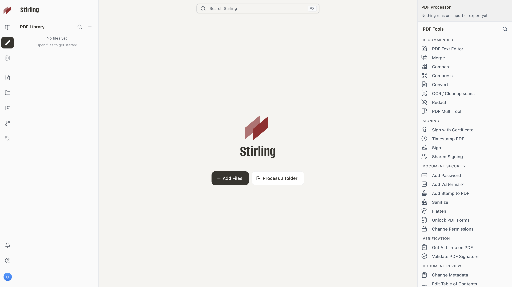

[English](./README.md) | 简体中文

<p align="center">
  
</p>

<h1 align="center">Stirling PDF —— 开源 PDF 平台</h1>

Stirling PDF 是一个功能强大的开源 PDF 编辑平台。它可以作为个人桌面应用运行，也可以在浏览器中使用，或者部署在你自己的服务器上并配备私有 API。编辑、签名、涂黑、转换和自动化处理 PDF，无需把文档发送到外部服务。

<p align="center">
  <a href="https://hub.docker.com/r/stirlingtools/stirling-pdf">
    
  </a>
  <a href="https://discord.gg/HYmhKj45pU">
    
  </a>
  <a href="https://scorecard.dev/viewer/?uri=github.com/Stirling-Tools/Stirling-PDF">
    
  </a>
  <a href="https://github.com/Stirling-Tools/stirling-pdf">
    
  </a>
</p>



## 核心能力

- **随处可用** —— 桌面客户端、浏览器界面，以及带私有 API 的自托管服务器。
- **50+ PDF 工具** —— 编辑、合并、拆分、签名、涂黑、转换、OCR、压缩等。
- **自动化与工作流** —— 在界面内直接使用无代码流水线，并可结合 API 处理数百万份 PDF。
- **企业级** —— 支持 SSO、审计，以及灵活的本地部署。
- **开发者平台** —— 几乎所有工具都提供 REST API，可集成进你现有的系统。
- **全球界面** —— 界面提供 40 多种语言。

完整功能列表见文档：**https://docs.stirlingpdf.com**

## 快速开始

```bash
docker run -p 8080:8080 docker.stirlingpdf.com/stirlingtools/stirling-pdf
```

然后打开：http://localhost:8080

完整的安装选项（包括桌面版和 Kubernetes）见我们的[文档指南](https://docs.stirlingpdf.com/#documentation-guide)。

## 资源

- [**文档**](https://docs.stirlingpdf.com)
- [**主页**](https://stirling.com)
- [**API 文档**](https://registry.scalar.com/@stirlingpdf/apis/stirling-pdf-processing-api/)
- [**服务器方案与企业版**](https://docs.stirlingpdf.com/Paid-Offerings)

## 支持

- **社区**：[Discord](https://discord.gg/HYmhKj45pU)
- **Bug 报告**：[GitHub Issues](https://github.com/Stirling-Tools/Stirling-PDF/issues)

## 贡献

欢迎贡献！请参阅 [CONTRIBUTING.md](.github/CONTRIBUTING.md) 了解贡献指南。

本项目使用 [Task](https://taskfile.dev/) 作为统一的命令运行器来执行所有构建、开发和测试命令。运行 `task dev` 启动编辑器，运行 `task` 查看常用命令，或参阅[开发者指南](docs/developer/DeveloperGuide.md) 了解完整细节。

如需添加翻译，请参阅[翻译指南](docs/developer/HowToAddNewLanguage.md)。

## 许可证

Stirling PDF 采用 open-core 模式。详情见 [LICENSE](LICENSE)。
